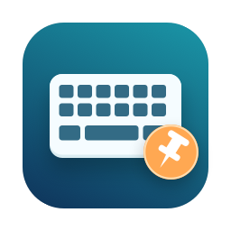

# Input Method Locked



轻量的 macOS 菜单栏输入法工具：固定全局输入法，也能为不同 App 指定独立输入法。

**[下载 DMG · v0.4.1](https://github.com/syczk301/Input-Method-Locked/releases/download/v0.4.1/Input-Method-Locked-0.4.1-universal.dmg)** · [全部版本](https://github.com/syczk301/Input-Method-Locked/releases)

## 功能

- 全局锁定输入法，切换 App 后自动恢复。
- 每个 App 可选择跟随全局、不锁定，或使用独立输入法。
- 支持多选 App 批量添加规则，自动保存本地设置。
- 原生菜单栏界面，主菜单只有六个操作项。
- 支持开机自动启动，状态与 macOS 登录项同步。
- 使用系统输入源 API，不读取输入文字，不联网。

例如：全局使用微信输入法，Terminal 使用 ABC，聊天 App 使用豆包输入法。

## 下载与安装

要求 **macOS 13 或更新版本**。DMG 为 Universal，包含 Apple silicon 和 Intel 二进制。

1. [下载 DMG](https://github.com/syczk301/Input-Method-Locked/releases/download/v0.4.1/Input-Method-Locked-0.4.1-universal.dmg)。
2. 打开 DMG，将 **Input Method Locked.app** 拖入 **Applications**。
3. 从 Applications 打开应用，在屏幕顶部找到键盘图标。

安装包采用本地 ad-hoc 签名，未经 Apple 公证。首次打开时，macOS 可能要求在“系统设置 → 隐私与安全性”中允许打开。

## 使用

- **全局输入法**：选择普通 App 使用的输入法。
- **当前 App**：为当前 App 选择跟随全局、不锁定或独立输入法。
- **应用规则**：管理已有规则，或通过“添加 App…”批量添加。
- **全局锁定**：开启或暂停全部规则。
- **设置**：开机自动启动、键盘设置和软件介绍。

在独立规则的 App 中修改全局输入法，不会覆盖该 App 的选择。离开该 App 后恢复全局输入法。

## 从源码构建

安装 Xcode Command Line Tools 后，在项目目录执行：

```sh
bash build.sh
open 'build/Input Method Locked.app'
```

默认构建 Universal 应用。编译缓存放在系统临时目录，构建产物放在 `build/`。

制作并核验 DMG：

```sh
bash Scripts/package-dmg.sh
```

输出为 `build/Input-Method-Locked-0.4.1-universal.dmg`，校验值见 `build/SHA256SUMS.txt`。

## 测试

```sh
bash Scripts/test.sh
```

自动化测试使用模拟 App 和输入源，覆盖全局规则、独立输入法、旧例外兼容、偏好回读和定时器生命周期。

只读查看本机输入源：

```sh
'build/Input Method Locked.app/Contents/MacOS/InputMethodLocked' --diagnose
```

实际输入源恢复检查（先退出正在运行的应用和其他输入法锁定工具）：

```sh
'build/Input Method Locked.app/Contents/MacOS/InputMethodLocked' --self-test
```

该检查短暂切换输入源，结束时恢复起始输入法。系统保护的输入框及第三方输入法的实际文字输入行为需要在对应 App 中验证。

实机验证环境为 Apple silicon / macOS 26；Intel 二进制为交叉编译。

## English

Input Method Locked is a native macOS menu-bar utility that keeps a chosen input source active. Set a global source, assign a different source to each app, or let selected apps switch freely. Rules are stored locally, and launch at login uses macOS Login Items.

[Download the Universal DMG](https://github.com/syczk301/Input-Method-Locked/releases/download/v0.4.1/Input-Method-Locked-0.4.1-universal.dmg), open it, and drag the app to Applications. Requires macOS 13+. The build is ad-hoc signed and not notarized; macOS may require approval in Privacy & Security on first launch. Intel support is cross-compiled; hardware validation was performed on Apple silicon.
